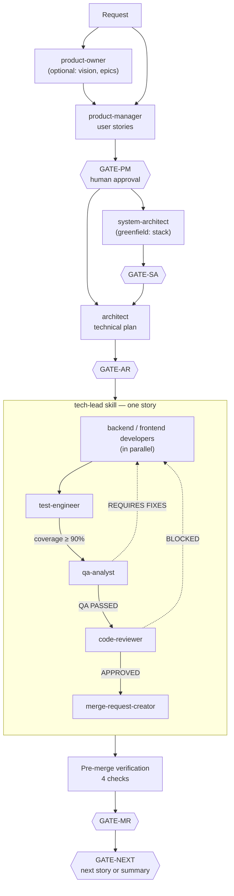

# claude_code-workflow

**A multi-agent SDLC pipeline for [Claude Code](https://claude.com/claude-code).**
It turns a feature request into a merged pull request through product, architecture,
implementation, testing, QA and code review, with human approval gates between stages,
quality gates inside every story, and guardrails enforced in code rather than in prompts.

Installs into any project's `.claude/` folder with a single self-contained shell installer.

---

## Why

AI coding agents are fast, but speed without process produces code that *looks* done:
untested branches, skipped reviews, merges of stale state. This workflow encodes the
discipline of a senior engineering team (separation of roles, definition of done,
nothing merges without tests, QA and review) and makes the agent follow it every time.

## The pipeline



- **Master (the main session) is a router only.** It reads state, picks the next stage and
  delegates. It never writes code, runs tests or edits files.
- **The `tech-lead` skill owns everything inside a story**: implementation → tests → QA →
  review → MR, including rework loops. A failed QA or review always restarts at
  implementation and re-runs tests and QA. There is no shortcut to the MR.
- **Five human gates** (`GATE-PM`, `GATE-SA`, `GATE-AR`, `GATE-MR`, `GATE-NEXT`). Three
  execution modes (`default`, `auto-gate`, `batch-auto`) let you trade supervision for
  throughput, set deterministically with `/mode`.
- **Pre-merge verification runs in every mode**: no open checklist items, QA report present,
  code-review report present, branch fully pushed. Any failure aborts the merge.

## What's inside

| Piece | Count | Notes |
|---|---|---|
| Specialist subagents | 34 | Product, architecture, UX, implementation, testing, QA, review, MR, DevOps, docs, context scouts |
| Language-specific variants | Node.js · Python · C · React · Angular · Vue | Separate developers, test engineers, reviewers and bug fixers per stack |
| Slash commands | 12 | `/story`, `/plan`, `/implement`, `/bugfix`, `/review`, `/qa`, `/mr`, `/mode`, `/project`, … |
| Skills | 13 | `tech-lead` orchestration, task management, test execution, Playwright debugging, container dev, docs lookup |
| Hooks | 11 Node.js scripts | Guardrails and context hygiene (see below) |
| Context library | ~45 files | Standards, workflows, stack guides and project memory, indexed by tags |

## Engineering decisions worth noting

**Guardrails in code, not in prompts.** A rule written in a prompt can be skipped silently
at the end of a long delegation chain. Critical rules are enforced by Claude Code hooks:

- `git-merge-guard.js` denies `gh pr create` / `gh pr merge` while the branch has
  uncommitted or unpushed work. This came from a real incident where a merge landed stale
  remote state. It also forces a human confirmation on any direct push to `main`/`master`,
  even in fully automatic modes.
- `artifact-frontmatter.js` injects consistent YAML metadata into every derived SDLC artifact,
  so the contract lives in one place instead of being repeated across ~17 agent prompts.
- `tmp-cache-guard.js` rewrites project-cache paths the model sometimes confuses with the
  OS-wide `/tmp`, preventing cross-project cache collisions.
- `rtk-guard*.js` wraps a token-saving command proxy and falls back to the raw command after
  repeated failures, so a filter bug can never trap the agent in a loop.
- All hooks **fail open** on infrastructure errors and **never** fail open on a detected violation.

**Context engineering.** A five-bucket context library (`standards`, `workflows`, `stacks`,
`meta`, `project`) is reached through a single tagged `INDEX.md`. A cheap `context-scout`
agent returns at most five files per task, each kept under ~200 lines (minimal viable information).

**Model tiering.** Each agent declares the model it needs: Opus for architecture and analysis,
Sonnet for implementation and review, Haiku for high-volume lookups and MR writing.
Code-generation agents never get a capped `max_tokens`, because truncated files are broken files.
An alternate profile maps every agent to Ollama Cloud models for personal projects.

**Resumable, auditable stories.** Each story keeps a checkpoint file and writes QA and
code-review reports as artifacts. Interrupted work resumes from the first unchecked item.
Story status and coverage feed an Obsidian Bases board.

**Multi-project umbrellas.** One install can drive several sibling repositories,
with every path and git operation anchored to the active sub-project (`/project`).

## Installation

Requirements: Claude Code, Node.js, Git and `jq`; the GitHub CLI (`gh`) for MRs.

```bash
# from this repo: build the self-contained installer
bash build-claude-installer.sh            # → claude-workflow-installer.sh

# install into a target project
bash install-claude.sh --dest /path/to/your-project
bash install-claude.sh --help             # all options (--provider, --no-tavily, --rtk-version …)
```

The installer copies the workflow into `<project>/.claude/`, downloads RTK from its upstream
release (it is never vendored here), sets up the Playwright MCP browser and asks which model
provider the project should use.

## Usage

```text
claude
> /story      Users must be able to export their portfolio as CSV
> /plan       STORY-012
> /implement  STORY-012
```

Or describe what you want in plain language. Master detects the current state from the
artifacts and routes to the right stage.

## Repository layout

```text
claude/                   # everything installed into <project>/.claude/
├── CLAUDE.md             # Master orchestrator instructions
├── settings.json         # models, hooks, permissions, MCP servers
├── agents/               # 34 specialist subagents
├── commands/sdlc/        # slash commands
├── skills/               # tech-lead and supporting skills
├── hooks/                # Node.js guardrail hooks
├── context/              # tagged context library
├── model-profiles/       # alternate model assignments (Ollama)
└── templates/            # Obsidian story-board templates
build-claude-installer.sh # packs claude/ into one installer script
install-claude.sh         # installs into a target project
```

## Status

Used on real projects, including a full-stack Node.js/React application with ~40 releases
built story by story through this pipeline. Testing means installing it into a real project
and exercising the flow; there is no automated test suite for the workflow itself yet.

This repository is the Claude Code edition. It was split out of an earlier OpenCode-based
version of the same workflow.

## Credits

Built on top of excellent open-source work:

- [RTK (Rust Token Killer)](https://github.com/rtk-ai/rtk): command-output compression, downloaded at install time
- [caveman](https://github.com/JuliusBrussee/caveman): terse-communication mode and its hooks
- [Playwright MCP](https://github.com/microsoft/playwright-mcp), [Tavily](https://tavily.com) and [Context7](https://context7.com): browser automation, web search and library docs

## Author

**Diogo Freitas**, Senior Software Engineer / Tech Lead
[LinkedIn](https://www.linkedin.com/in/diogo-figueiroa-freitas)
